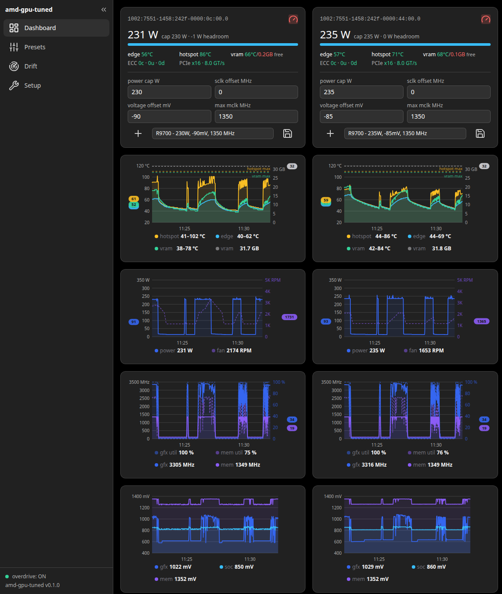

# amd-gpu-tuned

A single-binary daemon that tunes the power cap and overdrive (sclk/mclk,
vddgfx undervolt) of your AMD GPU — cooler, quieter, just as fast — with a
live web dashboard that charts every card's power, temperatures, clocks, and
voltages in real time.

**Linux only, AMD only** — built on the `amdgpu` kernel driver's
sysfs/overdrive interfaces. Tested on the **AMD Radeon™ AI PRO R9700**;
other AMD cards may work but are untested.

The daemon binds to `127.0.0.1:8787` only — loopback, never the network.
The port can be changed with the `--port` flag. All write endpoints are
gated by an optional password (reads stay open) — see
[Write password](#write-password).

*Live dashboard: dual R9700 with applied presets (230 W / −90 mV, 235 W /
−85 mV), per-GPU thermals and power/fan/clock history.*

## Requirements

- Linux + amdgpu kernel driver, RDNA3/RDNA4 GPU(s)
- GPU overdrive feature enabled: `amdgpu.ppfeaturemask` must include bit
  `0x4000` (without it the `pp_od_clk_voltage` table is absent and sclk/voltage
  tuning is impossible). `GET /api/setup` reports the live mask and whether
  the bit is set.
- If the bit is missing, set it on the kernel command line: take the current
  mask (shown by `GET /api/setup` as `live_mask`, or from
  `/sys/module/amdgpu/parameters/ppfeaturemask`), OR it with `0x4000`, and add
  `amdgpu.ppfeaturemask=0x<new mask>` to `GRUB_CMDLINE_LINUX` in
  `/etc/default/grub`, then `sudo update-grub` (Debian/Ubuntu; `grub2-mkconfig`
  on other distros) and reboot.

## Build & run

    cargo build --release
    sudo ./target/release/amd-gpu-tuned      # writes to /sys need root

Options:

- `--port` (8787), `--data` (./data — directory; DB is `<data>/amd-gpu-tuned.db`),
  `--poll-s` (1.5), `--record-s` (0.25 — fast sub-sample for telemetry
  aggregation; 0 disables it).
- `--fake-sysfs <path>` — enumerate GPUs from a captured sysfs fixture tree
   (e.g. `fixtures/sysfs`) instead of `/sys/class/drm`. Used by the e2e tests;
   no hardware or root required.

### systemd (runs as root — sysfs writes require it)

    sudo cp contrib/systemd/amd-gpu-tuned.service /etc/systemd/system/
    sudo systemctl daemon-reload
    sudo systemctl enable --now amd-gpu-tuned

## UI

The daemon serves a Svelte 5 SPA on the same origin (`http://127.0.0.1:8787/`).
It is built to `ui/dist` and embedded into the release binary (`rust-embed`) —
the running box makes **zero external network requests**.

- One-shot build (SPA + release binary): `sh scripts/build.sh`
- UI dev loop: `cd ui && npm install && npm run dev` (Vite on :5173; point it at
  the daemon with a proxy if you want live API data), then `cargo run` for the
  daemon — debug builds read `ui/dist` from disk, so no Rust recompile is needed
  for CSS/JS changes.
- UI gates: `cd ui && npm run check && npm run test && npm run build`
- e2e (no hardware): `cd ui && npm run e2e` — launches the release daemon with
  `--fake-sysfs fixtures/sysfs` and drives the embedded SPA with Playwright.

## Presets (per-slot)

A preset's `settings` is a map of **PCI slot id → per-GPU settings** —
one block per card, so the cards can be tuned differently. Each
block is sparse (only the knobs you set are stored/applied), and a GPU
with no entry is **untouched** (no writes, empty per-GPU outcome).

    {
      "name": "Quiet 250W",
      "notes": "",
      "settings": {
        "1002:75b4-1458:242f-0000:0a:00.0": {
          "power_cap_w": 250.0,
          "sclk_offset_mhz": 50,
          "voltage_offset_mv": -20
        },
        "1002:75b4-1458:242f-0000:0b:00.0": {
          "power_cap_w": 300.0
        }
      }
    }

Per-GPU knobs (all optional): `power_cap_w`, `sclk_offset_mhz`,
`max_mclk_mhz`, `voltage_offset_mv` (negatives only). `POST
/api/apply` accepts `overrides` as the same slot → settings map
(merged per slot — override fields win); export carries the map
unchanged.

See `docs/r9700-mclk-undervolt-notes-2026-10-12.md` for R9700-specific tuning
findings (mclk stability limit, undervolt × power-cap interplay, and the
iso-performance cap rule of thumb).

## Drift

The daemon periodically compares the live sysfs readback with the state it
intended. When the hardware disagrees — an out-of-band write by another tool,
a driver reset, or a card crash that snaps the settings back to stock — a
**drift episode** is opened in the drift ledger (`GET /api/drift`) recording
the detected values, the intended values, and which state was active
(`adhoc` / `stock` / …).

That ledger is the post-mortem: when a card crashes and resets to stock, the
episode shows exactly which settings were in force when it happened. Episodes
also append an `external_drift` event to the event log.

Two behaviors, configurable on the Setup page:

- **Re-apply** (default): after a short delay the daemon re-applies the
  intended state — the drift is corrected automatically.
- **Adopt**: the out-of-band state is taken over as the new active state
  (e.g. you tuned the card manually and want the daemon to follow, not fight
  you).

## Write password

The daemon runs as **root** and its write endpoints mutate GPU hardware
state, so an optional shared password gates **all writes** while every read
(status, telemetry, presets, drift, events, exporter) stays open. With no
password stored the daemon is in **open mode** — the gate is a no-op and
`GET /api/status` reports `"auth_enabled": false`.

    amd-gpu-tuned set-password            # prompt twice (min 8 chars)
    amd-gpu-tuned set-password --clear    # delete the hash → open mode

- The password is stored as an **argon2id hash** in the SQLite `meta`
  table — no plaintext anywhere. `--data` must match the daemon's data
  directory; the resolved db path is printed on success.
- Takes effect on a **running daemon** — no restart (the hash is read per
  unlock); re-running `set-password` changes the accepted password the same
  way, and so does `--clear`.
- UI: a write that comes back `401` opens a password modal. The returned
  token lives **in memory only** (never `localStorage`), is valid for
  30 minutes (sliding — each authenticated write extends it), and is lost
  on page reload or daemon restart (fails closed). The sidebar footer shows
  "unlocked"/"locked"; clicking "unlocked" locks now. The Setup page shows
  a "no write password set" note in open mode.
- API: `POST /api/auth/unlock {"password": …}` → `{token, ttl_s}` (400 if
  no password is configured, 401 on a bad password — appended to the event
  log as `auth_unlock_failed`). Gated writes then send
  `Authorization: Bearer <token>`; missing/expired/unknown → 401
  `{"error": "authentication required"}`. `POST /api/auth/lock` (itself
  gated) drops all tokens.
- Tokens are in memory only: a daemon restart re-locks every client. The
  internal re-apply paths (boot / logind / uevent) bypass HTTP and are
  unaffected.

## API (127.0.0.1:8787)

- `GET /` — Svelte SPA (web UI)
- `GET /api` — service index (endpoint list)
- `GET /api/status` — verified live state per GPU + baseline age + uptime
- `GET /api/setup` — hardware checklist (live ppfeaturemask, node presence)
- `POST /api/setup/verify` — re-run the checklist on demand
- `GET/POST /api/setup/ring` — telemetry ring window (minutes)
- `GET/POST /api/setup/drift` — drift-recovery options (`reapply`,
  `delay_s`); `GET /api/drift` (history + pending), `DELETE /api/drift`
  (clear history)
- `POST /api/auth/unlock`, `POST /api/auth/lock` — write-password auth
  (see [Write password](#write-password))
- `GET/POST /api/presets`, `PUT/DELETE /api/presets/{id}`,
  `GET /api/presets/{id}/export`, `POST /api/presets/import`
- `POST /api/apply` `{preset_id?, overrides?}` — per-knob
  `verified|applied|failed|skipped`
- `POST /api/revert` — stock settings (from the captured baseline)
- `POST /api/baseline` — recapture the stock baseline
- `GET /api/telemetry`, `GET /api/telemetry/stream` (SSE, ~1.5 s)
- `GET /api/events?since=<ms>&limit=<n>`
- `GET /api/exporter/metrics` — Prometheus text (`gpu_tune_*`)

## AI disclosure

This project was **created and is maintained by LLM agents** ([OpenCode](https://opencode.ai/)
with the [Superpowers](https://github.com/obra/superpowers) workflow), with human
direction and review. There is no hand-written code in this repository.
Per-feature validation notes are preserved in `docs/realworld/`.

## License

MIT — see [LICENSE](LICENSE).
